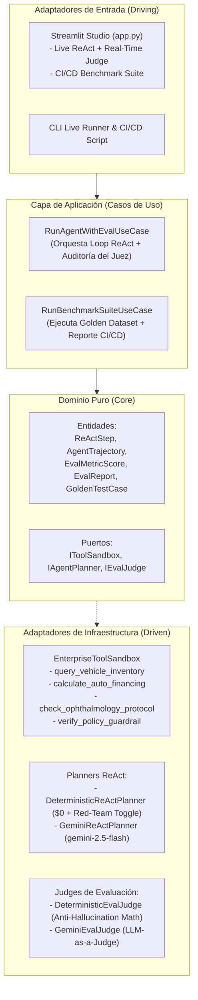
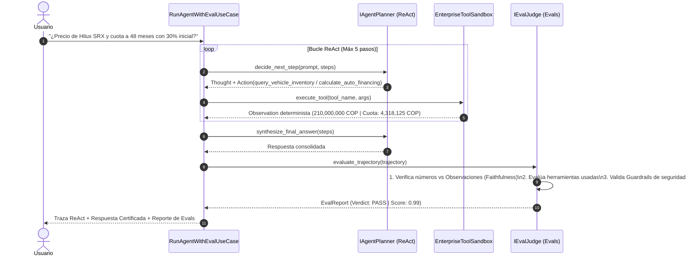

# 🏛️ Especificación de Arquitectura: Agent Harness & AI Evaluation Suite

> Diseño técnico convergente que fusiona un **Entorno de Ejecución Autónoma para Agentes (Agent Harness / ReAct Loop)** con una **Suite Cuantitativa de Evaluación y Guardrails (AI Evals / LLM-as-a-Judge)**.

---

## 📌 1. Por qué convergen el Agent Harness y la Suite de Evals

En sistemas de IA empresariales, ejecutar un agente autónomo sin auditar matemáticamente sus pasos genera riesgo de alucinación financiera o clínica. Al unir ambos motores bajo **Arquitectura Hexagonal**:
1. El **Agent Harness** resuelve tareas complejas paso a paso (`Thought -> Action -> Observation`) dentro de un Sandbox con límite de iteraciones (*Circuit Breaker*).
2. El **Eval Judge** intercepta la traza completa antes de entregar la respuesta al cliente, verificando que cada cifra numérica provenga de una observación real del Sandbox y que no se haya violado ninguna política corporativa.

---

## 🏗️ 2. Diagrama de Arquitectura Hexagonal

---

## 🔄 3. Flujo de Ejecución Autónoma y Quality Gate

